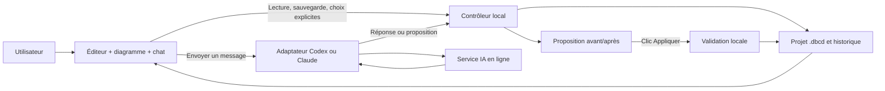

# Architecture cible et responsabilités

## Architecture recommandée

Une application desktop contient quatre couches :
1. une interface React reprenant l’atelier ;
2. un contrôleur local de projet et de discussions ;
3. une couche de stockage transactionnel ;
4. des adaptateurs Codex et Claude Code, lancés en processus séparés.

L’interface ne peut pas exécuter des commandes arbitraires. Une API locale étroite relie ses commandes au contrôleur.

Les flèches de cette architecture sont des intentions, pas des fonctionnalités toutes déjà implémentées.

## Chat, protocole agent et MCP

Le chat intégré est une interface de messages. Il utilise le protocole du moteur sélectionné :
- Codex app-server pour les conversations Codex ;
- Claude Code programmatique ou Agent SDK pour Claude.

MCP est une passerelle possible pour exposer des lectures structurées et des opérations contrôlées de projet à des assistants externes. Ce n’est ni l’interface de chat, ni le modèle, ni une condition obligatoire pour chaque échange interne.

Le logiciel peut utiliser directement ses services locaux pour appliquer une proposition validée. Si un MCP est conservé, les outils accessibles pendant une discussion doivent être limités à la lecture ; un outil d’application réservé à l’interface ne doit pas devenir appelable par le modèle.

## Réutilisation du dépôt

- `packages/core` : parser, contrats, présentation, confinement, stores, révisions, import/export.
- `packages/ui` : éditeur, canvas, vues, groupes, historique, conflits.
- `packages/mcp` : outils existants ; utile pour compatibilité et intégration secondaire.
- `packages/desktop` : emplacement déjà amorcé pour la nouvelle enveloppe, à auditer avant usage.

Ne pas dupliquer le moteur de sauvegarde ni créer un second historique concurrent.

## Frontière de sécurité du processus IA

Dire au modèle « ne modifie rien » ne suffit pas. Il faut une frontière technique :
- ne pas lui donner le service d’écriture du projet ;
- désactiver les outils d’exécution et les MCP hérités lorsqu’une option officielle le permet ;
- refuser les demandes d’élévation ou de contournement ;
- travailler dans un répertoire de session dédié, sans exposition implicite du projet entier ;
- vérifier le confinement réellement appliqué sur Windows.

**Point relevé pendant l’audit : désactiver le shell Codex n’implique pas nécessairement la disparition du builtin apply_patch.** La future implémentation devra tester les permissions effectives. L’existence d’un outil annoncé n’est pas la preuve qu’il peut écrire, et une configuration déclarée n’est pas la preuve qu’il est bloqué.

Si cette frontière ne peut être garantie avec une version du moteur, l’intégration doit refuser le mode concerné ou adopter un chemin de génération sans outils. Ne pas assouplir les permissions pour rendre un test heureux.

## Renderer et processus principal

Pour Electron :
- renderer sans Node, avec isolation de contexte et sandbox ;
- preload restreint à des méthodes typées ;
- validation runtime de chaque requête IPC ;
- ouverture de fichiers via dialogue natif ;
- pas de ressources web arbitraires, CDN ni HTML de réponse IA non assaini ;
- annulation, timeout et fin de processus contrôlés.

Le modèle parle au fournisseur sur Internet. L’éditeur et la base restent locaux. L’utilisateur autorise le partage de contexte lorsqu’il envoie un message ; aucun modèle ne doit être appelé automatiquement au démarrage.

## Concurrence

Le fichier a une identité et une génération. Les discussions, propositions et sessions d’éditeur gardent leur version de base.

La V1 peut sérialiser les requêtes IA par projet, tout en permettant de changer d’onglet de discussion. Plusieurs projets peuvent être ouverts simultanément dans des fenêtres ou instances distinctes. Une seule fenêtre possède le droit d’éditer un même projet ; les ouvertures supplémentaires sont en lecture seule. Ce droit doit être contrôlé entre processus, pas seulement dans l’interface. Les écritures de projet restent sérialisées et transactionnelles ; les modifications externes doivent être détectées, pas fusionnées silencieusement.

Le format existant contient un seul brouillon. Ne pas annoncer une isolation de brouillons par discussion ou par fenêtre tant qu’elle n’est pas conçue et testée.

