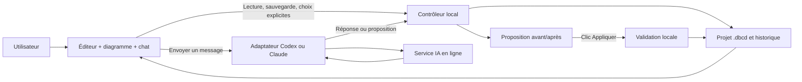

# DBCodex — dossier complet de migration vers une application autonome

13 octobre 2026. Spécification et reprise ; aucune application autonome livrée par ce dossier.

## Documents inclus

- 00-LIRE-DABORD.md
- 01-SPECIFICATION-PRODUIT.md
- 02-DECISIONS-ET-PRIORITES.md
- 03-ARCHITECTURE-CIBLE.md
- 04-DONNEES-ET-MIGRATION.md
- 05-INTERFACE-ET-PARCOURS.md
- 06-CODEX-CLAUDE-AUTHENTIFICATION.md
- 07-ETAT-REEL-DU-CODE.md
- 08-PLAN-DE-DEVELOPPEMENT.md
- 09-VALIDATION-ET-ACCEPTATION.md
- 10-RISQUES-ET-POINTS-OUVERTS.md
- 11-PROMPT-NOUVELLE-CONVERSATION.md


---

# Dossier de migration — DBCodex autonome

**Date : 13 octobre 2026. Produit : DBCodex. Destination : une nouvelle conversation de développement.**

## Pourquoi ce dossier

Le projet a commencé comme plugin Codex avec interface intégrée. Après essais, l’utilisateur souhaite désormais un logiciel Windows indépendant, conservant l’éditeur DBML et le diagramme, avec un chat Codex ou Claude Code. Plusieurs discussions peuvent traiter le même projet. L’assistant prépare des propositions ; l’utilisateur décide lesquelles appliquer et peut restaurer des versions.

Ce dossier sert à reprendre le travail sans perdre les décisions ni confondre un prototype avec une fonctionnalité livrée.

## Instruction prioritaire pour la reprise

**La conversation précédente devait rester en spécification.** L’expression « fais les meilleurs choix pour moi » signifiait présenter les recommandations, pas lancer leur développement. Un début de développement a malgré tout eu lieu, puis a été interrompu à la demande de l’utilisateur. Les éléments partiels sont conservés et signalés.

La présente mission consiste exclusivement à rédiger et empaqueter ce dossier. Elle ne relance aucun développement. Dans la nouvelle conversation, le prompt de départ fourni permet à l’utilisateur de demander explicitement l’implémentation.

## Ordre de lecture

1. **11-PROMPT-NOUVELLE-CONVERSATION.md** : mission prête à copier.
2. **01-SPECIFICATION-PRODUIT.md** : objectif et parcours attendus.
3. **02-DECISIONS-ET-PRIORITES.md** : décisions et recommandations à respecter.
4. **07-ETAT-REEL-DU-CODE.md** : état local, preuves et travaux incomplets.
5. **03-ARCHITECTURE-CIBLE.md**, **04-DONNEES-ET-MIGRATION.md**, **05-INTERFACE-ET-PARCOURS.md**.
6. **06-CODEX-CLAUDE-AUTHENTIFICATION.md**, **08-PLAN-DE-DEVELOPPEMENT.md**, **09-VALIDATION-ET-ACCEPTATION.md**, **10-RISQUES-ET-POINTS-OUVERTS.md**.

**DOSSIER-COMPLET.md** rassemble ces documents pour une seule pièce jointe.

## Où reprendre

Checkout à utiliser :
`C:/Users/qcham/.codex/worktrees/dbcodex-workbench/dbcodex`

Branche : `codex/dbcodex-workbench`.
HEAD observé : `aa0f1ae9f87f98742c15718c58b1e3e0fe638dff`.

Le `main` local est resté à `bcd3ae2` et ne contient pas l’atelier développé. **Un clone de GitHub ou un changement vers main ne suffit pas à récupérer le travail local non commité.** Aucune vérification de l’état distant n’a été faite pour ce dossier.

## Ce qui est réellement disponible

- Un atelier DBML/.dbcd existant avec édition, diagramme, vues, groupes, brouillons et révisions.
- Un plugin local installé en version `0.1.0-dev.0+codex.20261009`.
- Des ajouts d’intégration native non commités.
- Un début de package desktop, sans application exécutable achevée ni connexion IA fonctionnelle livrée.

Les 334 tests du socle ont été observés réussis avant l’ajout des fichiers desktop incomplets. Cela ne signifie pas que la suite actuelle entière passe.

## Archive et pièces techniques

Le dossier peut contenir :
- `annexes/etat-git.txt` : relevé des modifications locales ;
- `annexes/modifications-suivies.patch` : diff contre HEAD ;
- `annexes/manifest-sources.json` : inventaire et empreintes des fichiers copiés ;
- `sources/` : copie de travail sélectionnée, y compris les fichiers non suivis indispensables ;
- `exemples/test-boutique.dbml` : exemple fictif créé pendant les essais.

La copie source exclut Git, node_modules, dist, les caches, les identifiants de connexion, .env et les bases de travail personnelles. Les fixtures de démonstration suivies par Git sont conservées. L’archive n’est pas un installeur et ne garantit pas un build.

Sur le même poste, travailler dans le checkout existant. Sur un autre poste, reconstruire à partir de `sources/`, lire le manifeste puis installer les dépendances. Ne pas appliquer le patch par-dessus la copie source : elle contient déjà ces changements.


---

# Spécification produit — DBCodex autonome

## Vision

DBCodex est un logiciel local pour comprendre, éditer et organiser des schémas DBML. Il réunit :
- un diagramme interactif ;
- un éditeur DBML synchronisé ;
- un projet .dbcd avec disposition et historique ;
- un espace de discussions avec Codex ou Claude Code ;
- des propositions de modification examinables avant application.

L’utilisateur garde la maîtrise de ses fichiers. Le logiciel fonctionne comme éditeur sans assistant installé ou sans Internet. L’assistance IA utilise un service en ligne, après un envoi volontaire.

## Objectifs de la première version autonome

1. Ouvrir, créer ou importer un projet par un dialogue de fichier Windows.
2. Réutiliser l’atelier actuel, sans remplacer React Flow ni CodeMirror.
3. Créer plusieurs discussions nommées pour le même projet.
4. Choisir Codex ou Claude Code à la création d’une discussion.
5. Poser des questions sans aucune écriture du schéma.
6. Préparer une proposition à partir d’un message ou des décisions de la discussion.
7. Examiner explication, opérations et différence avant/après.
8. Appliquer explicitement une proposition validée.
9. Détecter les changements concurrents et refuser les propositions périmées.
10. Consulter l’historique et restaurer une version en conservant les versions suivantes.
11. Retrouver le projet, les discussions et les propositions après fermeture.
12. Annuler une requête IA sans endommager le projet.

## Règle principale : discuter n’est pas appliquer

Une phrase ambiguë telle que « Est-ce qu’on pourrait ajouter un champ ? » ne doit jamais changer le fichier. Même une demande explicite « Ajoute un champ » passe par une proposition visible dans cette première version.

Le texte de l’utilisateur ne débloque pas directement l’écriture. L’action **Appliquer** dans le panneau de proposition est la seule confirmation suffisante pour appliquer cette proposition précise.

La génération d’une proposition peut stocker la proposition et les messages localement ; elle ne modifie ni le DBML enregistré, ni sa présentation, ni son historique de versions appliquées.

## Plusieurs discussions, un seul modèle

Exemples :
- « Modèle clients » ;
- « Facturation » ;
- « Revue des relations » ;
- « Performance et index ».

Chaque discussion conserve ses messages, son assistant, ses paramètres de contexte et ses propositions. Le modèle enregistré, la présentation et l’historique de projet sont communs. Une application de changement provenant d’une discussion doit être visible partout.

Une discussion n’est pas une branche de schéma. La V1 ne gère pas plusieurs versions divergentes du modèle en parallèle. Les propositions peuvent être alternatives, mais seule la version enregistrée commune est la source de vérité.

## Portée fonctionnelle à préserver

Le socle actuel comprend des vues, groupes, positions, niveaux de détail, recherches, historique et brouillons. La migration doit les conserver. Toute modification du texte doit préserver le reste du DBML et ses commentaires.

Les noms, notes ou données d’exemple d’un projet peuvent être sensibles. Le partage vers l’IA doit être explicitement défini et visible. Le diagramme ne provoque aucun appel IA lorsqu’une table est simplement sélectionnée ou déplacée.

## Hors périmètre de cette migration

- exports PNG/SVG encore non livrés, couverture DBML avancée et autres chantiers sans rapport direct ;
- collaboration cloud, hébergement de projets ou édition multi-utilisateurs temps réel ;
- connexion aux bases de production ou collecte de secrets ;
- génération silencieuse de commits Git ;
- marketplace/publication publique avant décision de licence et de distribution ;
- génération du schéma par une IA sans validation utilisateur ;
- déplacement du logiciel dans un navigateur externe ;
- changement global de framework ou refonte de l’éditeur.

## Critère de réussite

L’utilisateur ouvre DBCodex, charge un .dbcd, discute avec l’assistant choisi, prépare puis applique une proposition après inspection, observe le diagramme actualisé et peut restaurer l’état antérieur. La fermeture puis la réouverture conservent les discussions, le projet et l’historique.


---

# Décisions, recommandations et ordre de priorité

## Hiérarchie à respecter

1. Demandes explicites de l’utilisateur dans la nouvelle conversation.
2. Intentions et recommandations les plus récentes reprises dans ce dossier.
3. Comportement existant qu’il faut préserver.
4. Spécifications historiques, lues avec leurs changements de périmètre.
5. Brouillons techniques incomplets du 13 octobre.

Le dossier ne transforme pas une hypothèse technique en capacité vérifiée.

## Tableau des choix

| Sujet | Choix de reprise | Statut |
| --- | --- | --- |
| Nom | DBCodex ; ne pas employer TB Codex | Confirmé explicitement |
| Produit | Application indépendante, avec sa fenêtre | Nouvelle direction retenue |
| Cible initiale | Windows | Recommandation adaptée au poste actuel |
| Éditeur/diagramme | Réutiliser CodeMirror et React Flow | Contrainte de continuité |
| Stockage du modèle | DBML exact comme vérité fonctionnelle ; projet SQLite .dbcd | Décision existante |
| UI générale | Éditeur gauche repliable, diagramme centre, discussions droite | Recommandation retenue pour spécifier |
| Discussions | Plusieurs discussions nommées par projet | Accord de principe utilisateur |
| Fournisseur | Assistant fixé par discussion | Recommandation présentée |
| Changer d’assistant | Nouvelle discussion ; pas de transfert implicite de l’historique | Recommandation présentée |
| Discussion | Lecture/analyse uniquement ; pas d’écriture du schéma | Exigence centrale |
| Préparation | Action explicite « Préparer une proposition » | Recommandation présentée |
| Application | Clic explicite après aperçu ; proposition appliquée en bloc | Recommandation présentée |
| Modification partielle | Réviser la proposition plutôt que décocher des opérations dépendantes | V1 recommandée |
| Périmètre envoyé | Vue active ou sélection visible, structure par défaut | Recommandation présentée |
| Données d’exemple | Exclues du contexte par défaut | Principe de confidentialité |
| Partage complet | Option explicite, avec aperçu du contenu | Recommandation |
| Proposition périmée | Bloquer, puis actualiser volontairement | Exigence de cohérence |
| Versions | Chaque application crée une révision | Décision de continuité |
| Restauration | Créer une nouvelle version ; conserver l’historique | Décision existante |
| Discussions portables | Avec le projet, idéalement dans le même .dbcd | Dernière recommandation fonctionnelle |
| Discussions lors d’une restauration | Conservées ; seul modèle+présentation sont restaurés | Recommandation de cohérence |
| Contexte IA lors d’un redémarrage | Reconstituer depuis les messages locaux et le projet actuel | Recommandation |
| Absence d’IA | L’éditeur reste utilisable | Exigence produit |
| Git | Aucun commit automatique | Contrainte utilisateur persistante |
| Licence et distribution | Toujours à décider avant publication | Décisions historiquement différées |

## Correction importante sur le stockage des discussions

Le code desktop partiel et le brouillon `2026-10-13-standalone-chat-design.md` supposent un compagnon `.dbcd.chat.sqlite`. Cette hypothèse a été choisie pendant le développement interrompu pour éviter de migrer le format.

**La dernière recommandation présentée à l’utilisateur privilégie un fichier projet unique.** La reprise doit donc étudier une évolution du .dbcd conservant les discussions dans le même conteneur. Cette préférence fonctionnelle n’autorise pas une migration destructive.

Si le fichier compagnon est conservé provisoirement, le mot « provisoire » et la procédure d’import ultérieure doivent être explicites. Ne pas simplement conserver l’architecture du brouillon parce qu’elle a déjà du code.

## Technologies : recommandation, pas dette obligatoire

Electron est le candidat principal : il permet de réutiliser la UI React dans une fenêtre native et de communiquer avec un moteur local. Les dépendances Electron ont déjà été ajoutées, mais aucune application autonome n’est achevée.

Comparer brièvement Electron avec une enveloppe Tauri et une application web locale. Electron privilégie la réutilisation ; Tauri demanderait une nouvelle couche Rust/interop ; une page de navigateur ne correspond pas à l’expérience demandée. Le choix technique doit rester au service du logiciel attendu.

## Ne pas rouvrir sans raison

Ne pas refaire les QCM de périmètre initial, proposer une réécriture du parser ou remettre le produit dans Codex Desktop. La migration peut conserver le plugin comme adaptateur secondaire, mais le parcours principal doit devenir l’application autonome.


---

# Architecture cible et responsabilités

## Architecture recommandée

Une application desktop contient quatre couches :
1. une interface React reprenant l’atelier ;
2. un contrôleur local de projet et de discussions ;
3. une couche de stockage transactionnel ;
4. des adaptateurs Codex et Claude Code, lancés en processus séparés.

L’interface ne peut pas exécuter des commandes arbitraires. Une API locale étroite relie ses commandes au contrôleur.



Les flèches de cette architecture sont des intentions, pas des fonctionnalités toutes déjà implémentées.

## Chat, protocole agent et MCP

Le chat intégré est une interface de messages. Il utilise le protocole du moteur sélectionné :
- Codex app-server pour les conversations Codex ;
- Claude Code programmatique ou Agent SDK pour Claude.

MCP est une passerelle possible pour exposer des lectures structurées et des opérations contrôlées de projet à des assistants externes. Ce n’est ni l’interface de chat, ni le modèle, ni une condition obligatoire pour chaque échange interne.

Le logiciel peut utiliser directement ses services locaux pour appliquer une proposition validée. Si un MCP est conservé, les outils accessibles pendant une discussion doivent être limités à la lecture ; un outil d’application réservé à l’interface ne doit pas devenir appelable par le modèle.

## Réutilisation du dépôt

- `packages/core` : parser, contrats, présentation, confinement, stores, révisions, import/export.
- `packages/ui` : éditeur, canvas, vues, groupes, historique, conflits.
- `packages/mcp` : outils existants ; utile pour compatibilité et intégration secondaire.
- `packages/desktop` : emplacement déjà amorcé pour la nouvelle enveloppe, à auditer avant usage.

Ne pas dupliquer le moteur de sauvegarde ni créer un second historique concurrent.

## Frontière de sécurité du processus IA

Dire au modèle « ne modifie rien » ne suffit pas. Il faut une frontière technique :
- ne pas lui donner le service d’écriture du projet ;
- désactiver les outils d’exécution et les MCP hérités lorsqu’une option officielle le permet ;
- refuser les demandes d’élévation ou de contournement ;
- travailler dans un répertoire de session dédié, sans exposition implicite du projet entier ;
- vérifier le confinement réellement appliqué sur Windows.

**Point relevé pendant l’audit : désactiver le shell Codex n’implique pas nécessairement la disparition du builtin apply_patch.** La future implémentation devra tester les permissions effectives. L’existence d’un outil annoncé n’est pas la preuve qu’il peut écrire, et une configuration déclarée n’est pas la preuve qu’il est bloqué.

Si cette frontière ne peut être garantie avec une version du moteur, l’intégration doit refuser le mode concerné ou adopter un chemin de génération sans outils. Ne pas assouplir les permissions pour rendre un test heureux.

## Renderer et processus principal

Pour Electron :
- renderer sans Node, avec isolation de contexte et sandbox ;
- preload restreint à des méthodes typées ;
- validation runtime de chaque requête IPC ;
- ouverture de fichiers via dialogue natif ;
- pas de ressources web arbitraires, CDN ni HTML de réponse IA non assaini ;
- annulation, timeout et fin de processus contrôlés.

Le modèle parle au fournisseur sur Internet. L’éditeur et la base restent locaux. L’utilisateur autorise le partage de contexte lorsqu’il envoie un message ; aucun modèle ne doit être appelé automatiquement au démarrage.

## Concurrence

Le fichier a une identité et une génération. Les discussions, propositions et sessions d’éditeur gardent leur version de base.

La V1 peut sérialiser les requêtes IA par projet, tout en permettant de changer d’onglet de discussion. Les écritures de projet restent sérialisées et transactionnelles. Une seconde fenêtre peut lire le projet ; les modifications concurrentes doivent être détectées, pas fusionnées silencieusement.

Le format existant contient un seul brouillon. Ne pas annoncer une isolation de brouillons par discussion ou par fenêtre tant qu’elle n’est pas conçue et testée.


---

# Données, version du format et migration

## État actuel

`packages/core/src/dbcd-schema.ts` définit **DBCD_FORMAT_VERSION = 1**. Le .dbcd contient :
- project_meta ;
- document_state, avec source DBML exacte et présentation ;
- draft_state ;
- revisions, avec snapshots compressés du modèle et de la présentation.

Les révisions actuelles ne contiennent pas de conversations. Les stores vérifient identité de projet, révision courante et génération. Les formats futurs inconnus sont traités selon le comportement existant de lecture seule ; les fichiers corrompus ne doivent pas être réécrits.

## Cible fonctionnelle

Un projet portable devrait regrouper modèle, présentation, historique, discussions et propositions dans un seul .dbcd. Ne pas inventer un schéma v2 définitif sans analyser les stores et la compatibilité v1.

Un schéma logique pourrait introduire :
- discussions : id, titre, fournisseur, dates, archivage, préférences de contexte ;
- messages : discussion, rôle, texte, état, mode, version et contexte associés ;
- propositions : discussion, explication, opérations, avant/après, base, statut ;
- paramètres de projet spécifiques au chat, sans identifiants de connexion.

Les comptes et tokens restent gérés par les mécanismes officiels des fournisseurs, hors du projet portable.

## Ce qui change de version, et ce qui n’en change pas

Séparer :
- la génération du modèle enregistré ;
- les modifications de présentation qui font partie d’une révision ;
- les messages et métadonnées de chat.

Recevoir un message ne doit pas rendre toutes les propositions périmées. Ajouter une discussion ne doit pas créer une nouvelle révision de schéma.

Une restauration de modèle restaure source et présentation. Elle ne supprime pas les discussions historiques ni les propositions rejetées/appliquées. Les propositions encore en attente sont requalifiées par rapport à la version restaurée.

## Proposition liée à sa base

Conserver au minimum :
- identité du projet ;
- identité de la discussion et fournisseur ;
- génération et révision de base ;
- empreinte de la source ;
- date ;
- opérations exactes ;
- avant/après vérifiable ;
- statut et révision d’application.

Comparer le schéma réel et les empreintes au moment d’appliquer. Refuser aussi un projet avec un brouillon non résolu. Une proposition ne doit pas écraser une saisie faite après sa préparation.

## Transactions

Avec un seul SQLite, l’application de proposition doit idéalement :
1. obtenir le verrou et ouvrir une transaction ;
2. revérifier identité, base, source et brouillon ;
3. valider le DBML final ;
4. enregistrer la nouvelle révision et la présentation préservée ;
5. marquer la proposition appliquée ;
6. incrémenter la génération pertinente ;
7. confirmer la transaction.

Une interruption doit laisser soit l’ancien état cohérent, soit le nouveau.

Le code partiel avec deux SQLite utilise un libellé `DBCodex proposal:<id>` pour retrouver une application après interruption. Ce mécanisme est un candidat de récupération, pas une transaction atomique commune. Le réévaluer si les données sont rassemblées.

## Migration v1 vers une version avec chat

Travail à spécifier/tester :
- sauvegarde de récupération avant conversion ;
- vérification de la signature, de la version et de l’intégrité ;
- migration transactionnelle à partir d’un état propre ;
- préservation exacte du texte, commentaires, layouts, brouillon et toutes les révisions ;
- comportement après interruption à chaque étape ;
- refus de migration silencieuse des formats plus récents ;
- compatibilité du plugin ancien avec le fichier migré ;
- procédure de retour vers la copie initiale.

Ne pas supprimer les anciennes données, historiques ou fichiers compagnons à l’import.

## Discussions et confidentialité

Un fichier projet partagé contenant le chat peut révéler des intentions métier et du texte envoyé aux fournisseurs. Prévoir :
- export DBML du modèle seul ;
- export de projet sans conversations ;
- explication claire lors d’un partage de projet complet ;
- suppression/archivage volontaire d’une discussion, avec règles explicites pour ses propositions ;
- aucune clé API ou session fournisseur dans le fichier.

## Brouillons et stockage de message interrompu

Les brouillons de l’éditeur, de la saisie de chat et les réponses partielles sont distincts. La fermeture ordonnée doit les préserver selon les règles prévues. Une réponse partielle ne doit jamais devenir une proposition applicable.

À la reprise, le logiciel indique « interrompu », « échoué » ou « prêt à réessayer ». Il ne relance pas de requête IA facturable sans une nouvelle action de l’utilisateur.


---

# Interface et parcours utilisateur

## Fenêtre

- Barre supérieure : projet, état enregistré/modifié, ouvrir/créer/importer, enregistrer.
- Éditeur DBML à gauche : repliable, diagnostics et sélection synchronisés.
- Diagramme au centre : vues, groupes, recherche, zoom et dispositions existants.
- Espace droit : liste des discussions, messages, champ de saisie et propositions.
- Historique de projet accessible depuis la barre supérieure.

Prévoir redimensionnement, focus clavier, thème et adaptation à une petite fenêtre. Éviter d’empiler plusieurs éditeurs ou d’ouvrir un navigateur externe.

## Accueil

L’utilisateur peut :
- ouvrir un projet récent ;
- choisir un .dbcd ;
- créer un projet ;
- importer un DBML dans un nouveau projet ;
- utiliser une démonstration fictive.

Si Codex/Claude est absent ou non connecté, afficher l’état et les étapes de connexion. L’éditeur doit tout de même fonctionner. Détecter une installation sans lancer d’inférence.

## Nouvelle discussion

Choisir un titre et un assistant. L’assistant reste attaché à cette discussion. L’utilisateur retrouve les discussions en revenant au projet.

La saisie non envoyée est propre à chaque discussion. Un changement d’onglet ne doit pas effacer un message en préparation.

## Contexte visible

Afficher un résumé tel que :
« Envoyé à Codex : structure de clients, commandes ; notes et données d’exemple exclues. »

Par défaut, utiliser les tables de la vue active ou une sélection explicite. Aucune sélection ambiguë ne doit signifier silencieusement « tout le projet ».

Afficher un aperçu du contenu réellement envoyé. L’élargissement de contexte est une action volontaire. Le texte déjà présent dans l’historique de cette discussion doit être pris en compte dans cet aperçu ou expliqué : réduire la sélection actuelle ne fait pas disparaître un contexte ancien déjà envoyé.

Si un patch exact demande une portion de source absente du contexte structurel, demander/présenter le fragment nécessaire ou utiliser une transformation locale vérifiée. Ne pas transmettre le DBML complet pour contourner cette limite sans signalement.

## Discussion

Exemple : « Est-ce pertinent de séparer les adresses ? »

Le logiciel ajoute un message utilisateur, envoie le contexte autorisé, affiche la réponse et propose éventuellement « Préparer une proposition ». Le projet enregistré ne change pas.

Même si le message contient « applique », le mode Discussion ne déclenche pas une écriture. La capacité d’application appartient à l’interface.

## Préparer

Exemple : « Prépare la séparation des adresses à partir de notre discussion. »

L’IA renvoie une proposition. Le logiciel vérifie ses opérations et sa cohérence. Le panneau montre :
- titre et explication ;
- tables/colonnes/relations concernées ;
- suppressions mises en évidence ;
- avant/après textuel ;
- aperçu du diagramme proposé si réalisable sans modifier le projet ;
- base et état : actuelle/périmée/invalide ;
- Appliquer, Réviser, Rejeter.

Ne pas présenter un changement de disposition comme une écriture DBML lorsque ce n’est pas le cas.

## Appliquer

Le bouton est disponible seulement si :
- proposition valide et actuelle ;
- projet éditable ;
- aucune sauvegarde/migration concurrente ;
- brouillon de l’éditeur résolu.

Un clic applique l’ensemble et crée une révision. Afficher le résultat et la possibilité de consulter l’historique. Pas de deuxième confirmation systématique pour des changements déjà examinés ; pour une opération destructrice majeure, la confirmation doit indiquer précisément ce qui sera perdu.

## Proposition périmée

Exemple : discussion A modifie clients, proposition de discussion B repose sur l’état précédent.

B conserve son historique et sa proposition originale, mais celle-ci ne peut plus s’appliquer. Afficher :
« Le projet a changé depuis cette proposition. »
Bouton : **Actualiser la proposition**.

L’actualisation ne masque pas la proposition précédente : conserver une trace ou la marquer remplacée. Elle ne fait aucun appel IA tant que l’utilisateur ne l’a pas demandée.

## Réviser ou rejeter

Réviser garde une proposition non applicable pendant la préparation de sa remplaçante. Rejeter ne modifie pas le projet et garde la trace dans la discussion.

Une proposition appliquée ne peut pas être appliquée une seconde fois comme un nouvel événement.

## Annuler et restaurer

Annuler une saisie locale suit le comportement actuel de l’éditeur/diagramme. Revenir sur une modification appliquée passe par l’historique et crée une nouvelle révision.

L’interface doit expliquer que restaurer un modèle ne supprime pas les conversations ni les versions plus récentes de l’historique.

## Erreurs et fermeture

Réponses incomplètes, perte de connexion, quotas atteints, CLI absent et login expiré sont des états distincts. Préserver message et projet, proposer une reprise.

Fermer pendant une sauvegarde attend sa fin puis conserve le brouillon restant. Un arrêt forcé reste soumis au dernier état effectivement écrit ; ne pas promettre une récupération magique de données jamais persistées.


---

# Codex, Claude Code et authentification

## Fonctionnement attendu

DBCodex possède sa propre interface de chat. Elle échange avec un moteur local :
- Codex app-server pour Codex ;
- Claude Code programmatique ou Agent SDK pour Claude.

Les moteurs peuvent être démarrés par DBCodex. Leur fenêtre desktop n’a pas besoin de rester ouverte. Installation, connexion authentifiée et accès Internet aux modèles sont nécessaires. L’éditeur doit rester utilisable hors ligne sans assistant.

MCP peut fournir des outils contrôlés ; il ne remplace pas le transport de conversation.

## Abonnement et frais : ne pas promettre trop

Pour le chemin « Sign in with ChatGPT » dans une application tierce, la documentation consultée le 13 octobre cite explicitement les utilisateurs Plus et Pro éligibles. L’usage partage les limites du compte. Business inclut Codex, mais son usage par ce chemin tiers n’a pas été confirmé dans cette conversation. Ne pas présenter l’ensemble des offres comme interchangeables.

Les connexions app-server d’applications locales/open source et le flux Sign in with ChatGPT doivent être distingués. Revalider les conditions au moment de l’implémentation et de la distribution. Le login ne doit pas être construit en recopiant des fichiers de tokens ni en utilisant un endpoint non documenté.

Pour Claude, les documents consultés indiquent l’authentification de Claude Code par les offres Pro/Max et Team/Enterprise, et l’usage du SDK/programmatique avec les limites d’abonnement à cette date. Les règles d’organisation et les conditions peuvent évoluer. Vérifier la méthode effectivement active : une clé API dans l’environnement peut changer le mode de facturation.

Une clé API ne doit pas être imposée. Un mode API peut être ajouté volontairement, avec affichage clair de la facturation distincte. Aucune consommation additionnelle silencieuse pour contourner un quota.

## Installation et diagnostic

Afficher séparément :
- moteur absent ;
- moteur trouvé, version connue ;
- connexion absente/expirée ;
- compte connecté ;
- accès au modèle refusé ;
- quota atteint ;
- requête en cours ou interrompue.

La simple présence d’un exécutable ne prouve pas une session valide ni un droit à un modèle.

Sur le poste actuel, Codex CLI a été observé en version 0.162.0-alpha.2 ; la commande résolvait un exécutable natif sous AppData/Local/OpenAI/Codex/bin. Claude Code n’a pas été trouvé. Ce sont des observations locales antérieures, pas des chemins à coder en dur.

## Adaptateur Codex

Prévoir handshake, démarrage/reprise de discussion, envoi de tour, messages progressifs, annulation et fin de session. Générer ou contrôler les schémas compatibles avec la version installée ; ne pas se fier uniquement à un exemple de documentation plus récent.

Les schémas avaient été générés sous .dbcodex/codex-protocol/v2 ; ce répertoire ignoré n’est pas nécessaire au dossier source et peut être régénéré.

Les mécanismes de désactivation d’outils doivent être vérifiés. Une option shell désactivé ne prouve pas à elle seule qu’apply_patch, les MCP hérités ou une autre capacité ne peuvent pas écrire. Refuser toute demande d’élévation et tester les accès réels au projet.

## Adaptateur Claude

Utiliser un mode programmatique documenté avec réponses structurées/progressives, reprise et interruption. Le SDK et le CLI ne doivent pas recevoir de permission d’écriture du projet pendant le chat.

Les options de restriction d’outils, les logins et les différences entre compte d’abonnement et Console doivent être testés avec la version installée. DBCodex n’installe pas Claude ni ne choisit une clé API silencieusement.

## Données partagées

Une requête envoie uniquement le message, l’historique autorisé de cette discussion et le contexte présenté à l’utilisateur. Les providers ne reçoivent pas implicitement toutes les conversations d’un projet.

Ne stocker aucun token fournisseur dans le .dbcd, dans les messages ou dans les journaux. Ne pas réutiliser une réponse du mauvais fournisseur/discussion après changement de projet.

## Sources officielles à reconsulter

- [Codex App Server](https://learn.chatgpt.com/docs/app-server)
- [Sign in with ChatGPT — intégration](https://developers.openai.com/siwc/quickstart)
- [Sign in with ChatGPT — fonctionnement utilisateur](https://learn.chatgpt.com/docs/sign-in-with-chatgpt)
- [Claude Code — authentification](https://code.claude.com/docs/en/authentication)
- [Claude Code — mode programmatique](https://code.claude.com/docs/en/headless)
- [Claude Agent SDK et abonnement](https://support.claude.com/en/articles/15036540-use-the-claude-agent-sdk-with-your-claude-plan)

La disponibilité technique, les conditions d’utilisation et la facturation sont trois vérifications distinctes. Ne pas interpréter ce dossier comme une garantie permanente de gratuité ou de compatibilité.


---

# État réel du code et preuves

## Dépôt et checkouts

Dépôt configuré : https://github.com/Qappyld/dbcodex.

| Checkout | Branche/HEAD local | Utilisation |
| --- | --- | --- |
| C:/Users/qcham/OneDrive - APPYLD/Documents/ChatGPT/dbcodex | main / bcd3ae2 | Documentation initiale ; README ancien |
| C:/Users/qcham/.codex/worktrees/compatibility-spike/dbcodex | codex/compatibility-spike / 2389170 | Prototype SVG/MCP |
| C:/Users/qcham/.codex/worktrees/dbcodex-workbench/dbcodex | codex/dbcodex-workbench / aa0f1ae | Atelier et changements locaux à reprendre |

HEAD complet du checkout d’implémentation : aa0f1ae9f87f98742c15718c58b1e3e0fe638dff, daté du 27 septembre 2026.

Le travail ajouté ensuite est non commité. Ne pas le perdre avec git reset/clean, un checkout forcé ou une reconstruction depuis main. Le relevé annexé décrit l’état au moment de constituer le dossier.

## Socle existant

- Parser DBML et diagnostics.
- Éditeur CodeMirror et diagramme React Flow.
- Vues, groupes, niveaux de détail, dispositions et navigation.
- Projet .dbcd SQLite v1 : source exacte, présentation, brouillon et révisions.
- Enregistrement explicite, détection de conflits, historique, épinglage et restauration.
- Import/export DBML.
- Serveur MCP local, empaquetage et skill.

Ne pas redévelopper cet atelier pour fabriquer la fenêtre autonome.

## Ajouts du 9 octobre — présents mais non commités

Entrées thread/global/file, lanceur de projet, patchs exacts via apply_dbcd_edits, rafraîchissement des versions enregistrées et flush du brouillon au teardown.

Le rapport docs/evidence/native-integration.md contient les commandes et résultats historiques. Il décrit 334 tests réussis, build/types, contrôle hors ligne et stdio du bundle installé. Ce n’est pas une acceptation de l’application autonome.

L’éditeur dans la conversation a été essayé par l’utilisateur, qui a jugé l’expérience peu satisfaisante. La demande de panneau droit a été envoyée et la navigation vers le chat a été effectuée ; aucun résultat visuel complet du panneau n’a été fourni. Le changement de direction produit vers une application indépendante prévaut désormais.

## Particularité vérifiée du plugin installé

Les outils de ce chat utilisaient leur dossier de cache comme racine locale. Le lanceur retournait une empreinte correspondant à :
C:/Users/qcham/.codex/plugins/cache/dbcodex-local/dbcodex/0.1.0-dev.0+codex.20261009.

Le projet fictif .dbcodex/test-boutique.dbcd a donc été créé dans ce cache. Import validé : 4 tables, 3 relations, aucun diagnostic. Cela ne justifie pas de stocker les futurs projets dans un cache de plugin : la nouvelle application doit choisir explicitement un fichier utilisateur stable.

## Début desktop interrompu — à auditer

| Fichier/groupe | État observé |
| --- | --- |
| packages/desktop/package.json | Déclaré ; pas de build/start desktop |
| src/shared/contracts.ts | Types de discussions, propositions, providers et API desktop |
| src/chat-store.ts | Début de store SQLite compagnon |
| src/chat-service.ts | Contexte structurel, préparation/application de patchs, réconciliation |
| src/renderer/DesktopApp.tsx | Début de UI desktop réutilisant l’atelier |
| test/chat-store.test.ts | Tests écrits, résultats non confirmés pour la livraison |
| test/chat-service.test.ts | Tests écrits, résultats non confirmés pour la livraison |
| test/renderer.test.tsx | Tests avec API simulée |
| test/desktop-service.test.ts | Importe src/desktop-service.js, actuellement absent |
| packages/ui/src/DbcdWorkbench.tsx | Callbacks de session/sélection ajoutés pendant le travail interrompu |
| package.json / package-lock.json | Electron 44.7.0 et @electron/packager 20.3.0 ajoutés |

Les providers, le service desktop complet, le processus principal Electron, le preload, l’entrée renderer, les styles dédiés, le packaging et la validation de fenêtre autonome ne sont pas livrés.

Les trois sous-agents ont été arrêtés lorsque l’utilisateur a précisé « spécification seulement ». Ne pas les relancer en conservant leurs anciennes consignes sans les adapter à la présente cible.

## Documents à lire avec réserve

Le brouillon docs/superpowers/specs/2026-10-13-standalone-chat-design.md affirme une autorisation de réaliser et suppose un compagnon SQLite. La correction de l’utilisateur révoque cette interprétation. Le plan correspondant n’est pas une autorisation autonome de poursuivre.

Le compagnon est une piste partiellement codée ; la dernière préférence fonctionnelle est de conserver les discussions avec le projet, idéalement dans le .dbcd. Le code existant ne tranche pas ce choix.

## Tests : ce que nous savons

1. Rapport du 27 septembre : 323 tests réussis.
2. Vérifications du 9 octobre : 334 tests réussis et contrôles techniques réussis.
3. Baseline relancée le 13 octobre avant les ajouts desktop : 334 tests, 33 fichiers, réussis.
4. Test desktop-service observé en échec attendu lors de sa création : module absent.
5. Après interruption et durant la rédaction du dossier : aucune suite complète relancée.

Les scripts build et typecheck actuels ciblent core/UI/MCP ; ils ne prouvent pas le bon fonctionnement du desktop même s’ils passent. npm test découvre aussi les nouveaux tests incomplets.

Deux alertes npm de sévérité haute avaient été observées ; elles sont documentées dans le rapport natif. Ne pas les déclarer corrigées ni faire un audit fix général sans analyser ses conséquences.

## Premier travail de la nouvelle conversation

Préserver l’état local et les données, séparer le socle des ajouts interrompus, établir une baseline actuelle et un plan de réparation. Toute réutilisation du code partial doit être revue et testée ; aucune fonctionnalité ne doit être marquée livrée parce qu’un fichier ou un test existe.


---

# Plan de migration et développement

Ce plan organise les futurs développements ; il n’a pas été exécuté pendant la préparation du dossier. Les cases vides sont des travaux restant à faire. Aucun commit automatique n’est prévu.

## Jalon 0 — Préserver et qualifier la base

- [ ] Ouvrir le checkout d’implémentation, lire état Git et ce dossier.
- [ ] Sauvegarder les données utilisateur et le travail non commité.
- [ ] Identifier les fichiers incomplets ; ne pas nettoyer globalement le dépôt.
- [ ] Relancer les contrôles actuels et qualifier les échecs.
- [ ] Vérifier les versions locales, sans requête IA facturable.
- [ ] Documenter le delta entre baseline et ajouts desktop.

Sortie : état initial reproductible, anomalies classées, aucun travail perdu.

## Jalon 1 — Stabiliser les frontières de la nouvelle application

- [ ] Choisir/confirmer l’enveloppe desktop par un prototype technique ciblé.
- [ ] Définir une API UI locale validée runtime.
- [ ] Définir les sessions projet, discussion, proposition et fournisseur.
- [ ] Séparer opérations de discussion, préparation et application.
- [ ] Définir les événements, annulations et erreurs.
- [ ] Ajouter le desktop aux contrôles build/types.

Sortie : contrat documenté ; aucun assistant ne détient l’écriture du projet.

## Jalon 2 — Fenêtre autonome sans IA

- [ ] Processus principal et preload sécurisé.
- [ ] Dialogue natif ouvrir/créer/importer.
- [ ] Chargement du fichier utilisateur avec confinement.
- [ ] Réutilisation du ProjectWorkbench.
- [ ] Sauvegarde, brouillon, historique et restauration.
- [ ] Projets récents et fermeture ordonnée.
- [ ] Test réel de lancement et réouverture.

Sortie : le logiciel est utile sans Codex ni Claude installés.

## Jalon 3 — Données de discussions et migration

- [ ] Spécifier l’évolution du .dbcd pour les discussions portables.
- [ ] Protéger sauvegarde préalable et migration transactionnelle.
- [ ] Tester la préservation des projets v1 et la lecture des formats futurs.
- [ ] Ajouter discussions, messages, paramètres et brouillons de chat.
- [ ] Revoir ou migrer le compagnon partiel existant.
- [ ] Garantir que les messages ne font pas avancer la génération de modèle.

Sortie : discussions persistantes ; source et anciennes révisions intactes.

## Jalon 4 — Providers en lecture seule

- [ ] Détection/connexion Codex, états de compte et permissions effectives.
- [ ] Protocole app-server compatible avec la version installée.
- [ ] Adaptateur Claude quand disponible ; erreur claire sinon.
- [ ] Annulation, timeout, streaming et nettoyage des processus.
- [ ] Vérification des outils hérités et des restrictions d’écriture.
- [ ] Contrôle du mode d’authentification et de facturation.
- [ ] Tests simulés avant inférence réelle volontaire.

Sortie : une discussion répond, mais ne peut pas changer le projet.

## Jalon 5 — Chat multi-discussions et contexte

- [ ] Discussions nommées et fournisseur fixe.
- [ ] Messages et saisies isolés par discussion.
- [ ] Contexte par vue/sélection, aperçu exact et partage explicite.
- [ ] Messages progressifs, interruption, reprise et quotas.
- [ ] Reconstitution des sessions sans transférer les autres discussions.
- [ ] Aucun envoi au provider à la simple ouverture/changement d’onglet.

Sortie : plusieurs discussions cohérentes, aucune écriture de schéma.

## Jalon 6 — Préparation et inspection des propositions

- [ ] Format strict de proposition et validation des limites.
- [ ] Patchs ciblés ou opérations structurelles locales vérifiables.
- [ ] Préservation des commentaires et syntaxe non rendue.
- [ ] Diff avant/après, résumé des suppressions et détails utiles.
- [ ] Réviser/rejeter et conserver la trace.
- [ ] Refuser une proposition tronquée, malformée, ambiguë ou DBML invalide.

Sortie : une proposition lisible et non appliquée.

## Jalon 7 — Application et concurrence

- [ ] Clic utilisateur seul point d’application.
- [ ] Vérifier identité, génération, révision, empreintes et brouillon sous verrou.
- [ ] Transaction source+présentation+révision+statut de proposition.
- [ ] Idempotence et récupération après interruption.
- [ ] Synchroniser les autres discussions et rendre les propositions anciennes périmées.
- [ ] Empêcher application pendant une édition non enregistrée.

Sortie : zéro application silencieuse ou écrasement de brouillon.

## Jalon 8 — Restauration et reprise

- [ ] Restaurer modèle+présentation sans effacer le chat ni l’historique.
- [ ] Requalifier les propositions après restauration.
- [ ] Préserver les dernières saisies lors d’une fermeture ordonnée.
- [ ] Distinguer arrêt forcé et récupération d’un état réellement persisté.
- [ ] Tester les cas fenêtre double, processus interrompu et fichier remplacé.

Sortie : reprise compréhensible et vérifiable.

## Jalon 9 — Packaging et acceptation Windows

- [ ] Build reproductible et exécutable local.
- [ ] Tester SQLite et les CLI avec les versions embarquées.
- [ ] Vérifier lancement sans terminal et absence de navigateur externe.
- [ ] Associer .dbcd seulement si testé et documenté.
- [ ] Tests clavier, thèmes, grande fenêtre/petite fenêtre.
- [ ] Démonstration sur copie de projet, pas sur une fixture originale.
- [ ] Documenter l’installation, la désinstallation et les limites.

Sortie : version locale réellement utilisable, preuves séparées des simulations.

## Livraison et hors périmètre

Les exports PNG/SVG, connexions bases, collaboration cloud et anciens chantiers V1 restent séparés. Ne pas élargir ce plan pour cacher une difficulté d’intégration.

Avant une publication : décider licence, gouvernance, distribution, conditions de connexion fournisseurs et politique de mises à jour. L’implémentation locale n’autorise pas automatiquement une publication commerciale.

## Discipline des tests

Pour chaque changement de comportement : cas qui échoue, correction minimale, vérification ciblée, puis contrôle du jalon. Conserver les tests existants. La documentation de preuve doit préciser version, commandes, résultat observé et limites.

Ne pas présenter une simulation comme une preuve de dialogue réel avec un compte ni un rendu navigateur comme une preuve de fenêtre autonome.


---

# Matrice de validation et critères d’acceptation

Tous les contrôles ci-dessous sont des exigences futures, sauf les preuves historiques explicitement indiquées dans 07. La création de ce dossier n’a pas exécuté cette matrice.

## Socle et migration

| Cas | Résultat exigé |
| --- | --- |
| Ouvrir un .dbcd v1 | Modèle, présentation et historique conservés |
| Migration interrompue | Fichier initial récupérable ou état migré cohérent |
| Format futur | Lecture seule ou refus clair, aucune conversion destructive |
| Fichier corrompu | Erreur assainie, pas d’écrasement |
| Notes/commentaires/Records | Préservés lors de modifications non concernées |
| Export modèle seul | DBML sans conversations ni brouillon non enregistré |
| Copier le projet complet | Discussions et propositions récupérables selon format final |
| Import d’un compagnon ancien | Pas de doublons, aucun effacement silencieux |

## Chat et confidentialité

| Cas | Résultat exigé |
| --- | --- |
| Ouvrir le logiciel | Aucun appel IA automatique |
| Poser « peut-on ajouter… ? » | Réponse uniquement, génération inchangée |
| Écrire « applique immédiatement » en discussion | Aucun changement sans action UI |
| Changer de discussion | Historique et saisie isolés |
| Changer de projet | Aucune réponse tardive injectée dans le mauvais projet |
| Contexte structurel | Aucune note, commentaire, donnée exemple ou secret de défaut |
| Partage complet | Option volontaire et aperçu identifiable |
| Provider absent/non connecté | Message clair ; éditeur fonctionnel |
| Annuler une requête | Réponse partielle marquée ; aucune proposition appliquée |
| Quota dépassé | Pas de passage silencieux à une clé API payante |
| Renderer recevant HTML hostile | Texte échappé ou rendu assaini |
| Logs | Aucun token ni copie inutile du schéma complet |

## Propositions

| Cas | Résultat exigé |
| --- | --- |
| Préparer | Stockage de proposition ; schéma inchangé |
| Patch absent/ambigu | Refus, aucune sauvegarde |
| Patchs chevauchants | Refus ou traitement déterministe explicitement validé |
| DBML final invalide | Appliquer désactivé, explication |
| Source non concernée | Conservation exacte |
| Refuser une proposition | Statut conservé ; aucune révision modèle |
| Appliquer une fois | Une nouvelle révision cohérente |
| Double clic/réessai | Pas de double application |
| Fichier modifié entre préparation et clic | Refus de proposition périmée |
| Brouillon créé entre lecture et transaction | Refus sous verrou, brouillon intact |
| Présentation modifiée ailleurs | Aucun écrasement silencieux |
| Réponse partielle/JSON tronqué | Jamais applicable |

## Plusieurs discussions et retour arrière

| Cas | Résultat exigé |
| --- | --- |
| A applique, B attend | B voit nouvelle base ; ancienne proposition bloquée |
| B actualise | Nouvelle proposition traçable, pas d’application automatique |
| Restaurer une révision | Nouvelle révision ; versions anciennes conservées |
| Restauration avec discussions | Conversations gardées et propositions requalifiées |
| Fermeture/réouverture | Modèle, vues, zoom, discussions, brouillons récupérés |
| Arrêt forcé | Limite documentée au dernier état écrit |
| Deux fenêtres | Conflits détectés ; pas de perte silencieuse |

## Sécurité effective des moteurs

Tester les tentatives de lancer une commande, modifier le .dbcd, utiliser un MCP hérité ou demander une élévation. Les protections doivent être observées, pas seulement supposées depuis un prompt ou une option CLI.

Une discussion ne doit pas exposer d’outil d’application du projet. Le test doit montrer qu’un message hostile ne contourne pas le clic utilisateur.

## Niveaux de preuve

1. Tests unitaires : logique de parsing, patchs, états.
2. Intégration : transactions, fichiers, IPC et transport de processus simulé.
3. UI automatisée : actions explicites, contexte et affichage.
4. Application réelle : exécutable Windows, ouvrir/enregistrer/fermer/reprendre.
5. Provider réel : connexion et inférence consentie, compte/modèle/version précisés.
6. Validation utilisateur : parcours complet et compréhension du avant/après.

Les couches 1–3 ne remplacent pas 4–6.

## Commandes existantes à relancer dans la nouvelle conversation

```text
npm ci
npm run build
npm run typecheck
npm test
npm run verify:offline-ui
npm run verify:mcp
```

Le build/typecheck actuels ne couvrent pas le desktop. Ajouter des commandes desktop, son typecheck et son contrôle d’exécutable, puis les documenter. Ne pas supposer qu’elles existent déjà.

Conserver le rapport des échecs dus au code interrompu. Écarter un test absent de la suite pour rendre le tableau vert ne constitue pas une résolution.

## Parcours final proposé

Sur un projet fictif :
1. Ouvrir le logiciel autonome et le projet.
2. Créer « Clients » avec Codex, poser une question ; vérifier zéro modification.
3. Préparer un changement ; examiner avant/après ; rejeter.
4. Préparer une seconde proposition et l’appliquer ; vérifier une révision.
5. Créer une autre discussion, puis provoquer une proposition périmée.
6. Actualiser volontairement, conserver un brouillon et vérifier le blocage.
7. Restaurer l’état initial, garder les conversations.
8. Fermer puis rouvrir et retrouver toutes les données prévues.
9. Tester Claude si installé, sans changer silencieusement de fournisseur.
10. Vérifier la consommation et la limite des données envoyées.

La livraison ne peut être déclarée complète avec seulement des fichiers de code, des tests simulés ou un screenshot de maquette.


---

# Risques, arbitrages techniques et limites

## Points à résoudre pendant l’audit, sans refaire la découverte produit

### Fichier unique et compatibilité

La préférence est un .dbcd contenant les discussions. Il faut prouver la migration v1 et le comportement des anciens clients. Le code compagnon partiel peut fournir des idées, mais ne définit pas la cible.

### Patchs et contexte restreint

Le modèle reçoit par défaut une structure filtrée, pas le texte complet. Des patchs exacts nécessitent parfois des fragments supplémentaires. Concevoir une transformation locale par opérations ciblées ou demander explicitement un fragment. Interdire la sérialisation intégrale du DBML qui détruirait les commentaires.

### Permissions des moteurs

Certaines options de Codex/Claude dépendent de leur version. Une sandbox lecture seule et le retrait du shell ne remplacent pas une vérification de tous les outils et MCP hérités. Le projet réel ne doit pas être implicitement accessible en écriture.

### Authentification et offre d’abonnement

Plus/Pro, Business, compte Claude et Console API ne doivent pas être confondus. Détecter le mode actif et présenter ce qui est réellement disponible. Les conditions de distribution d’une application intégrant ces moteurs doivent être revalidées avant publication.

### Conversation longue

Définir pagination, limites, recherche et éventuel résumé de contexte. Garder le transcript local original. Une synthèse envoyée doit être identifiable ; ne pas annoncer une mémoire exhaustive si le contexte a été réduit.

### Modifications graphiques

La V1 peut limiter les propositions IA à la structure du modèle. Si positions, vues ou groupes sont proposés, les différencier du texte DBML et inclure leur état de base dans les vérifications. Ne pas annuler une disposition récente pour appliquer un changement de colonne.

### Brouillons et fenêtres multiples

Le store actuel comporte un seul brouillon. Plusieurs discussions ne signifient pas plusieurs éditeurs indépendants. Fixer un éditeur actif par projet en V1, ou concevoir explicitement une isolation de brouillons.

### Interruption et quotas

Les processus doivent être annulables et nettoyés. Aucun redémarrage automatique de requête susceptible de consommer le quota. Préserver messages/propositions et expliquer le résultat.

### SQLite embarqué

Tester le module de stockage avec le runtime choisi pour l’application et les binaires empaquetés. La présence de node:sqlite dans le Node de développement n’est pas une preuve pour un autre runtime.

### Packaging

Portable ou installateur sont des options à choisir après le prototype fonctionnel. Les signatures, mises à jour, associations de fichiers et désinstallation demandent une validation dédiée ; elles ne sont pas garanties par l’installation d’Electron.

## Décisions différées historiques

Licence open source et mode de distribution n’ont pas été définitivement choisis. Ne pas ajouter une licence par défaut ni annoncer une release publique.

## Points de dette conservés

Les alertes de dépendances connues, la couverture DBML exhaustive, les exports PNG/SVG et l’acceptation native de l’ancien plugin ne disparaissent pas. Ils ne doivent pas envahir la migration autonome ni être déclarés résolus.

## Ce qui n’est pas demandé

Aucun abonnement facturé par DBCodex, service cloud de stockage, télémétrie implicite, publication automatique ou capacité IA d’exécuter librement des commandes sur le poste. Toute évolution correspondante serait un nouveau choix produit.

## Priorité des arbitrages

1. Préservation et frontière d’écriture.
2. Format et migration.
3. Fenêtre réellement fonctionnelle.
4. Chat puis propositions.
5. Packaging.
6. Extension des fonctionnalités.

Présenter une difficulté concrète et une recommandation quand un choix manque. Ne pas redemander la permission pour chaque détail réversible déjà dans la mission, mais ne pas transformer une demande de spécification en autorisation de développer.


---

# Prompt de départ — à copier dans la nouvelle conversation

Le texte ci-dessous est destiné à être envoyé volontairement par l’utilisateur dans une nouvelle conversation. Sa présence dans une pièce jointe n’autorise pas à elle seule le développement dans la conversation qui prépare ce dossier.

---

Je veux poursuivre le projet **DBCodex** et développer une application Windows autonome, avec l’éditeur et le diagramme existants, un chat intégré Codex/Claude Code, plusieurs discussions par projet et des propositions de modifications appliquées uniquement après validation explicite dans l’interface.

**Dans cette nouvelle conversation, je t’autorise à réaliser les développements décrits dans le dossier de migration joint.** Commence par l’audit de la base locale et un plan concret, puis exécute les jalons autorisés sans refonte générale.

## Base à utiliser

Checkout : C:/Users/qcham/.codex/worktrees/dbcodex-workbench/dbcodex
Branche : codex/dbcodex-workbench
HEAD connu : aa0f1ae9f87f98742c15718c58b1e3e0fe638dff

Lis 00-LIRE-DABORD, 01-SPECIFICATION-PRODUIT, 02-DECISIONS-ET-PRIORITES et 07-ETAT-REEL-DU-CODE, puis les documents techniques, le plan et la matrice de validation.

Si ce checkout n’est pas disponible, utilise la copie sources fournie dans l’archive. Ne repars pas du README ancien de main ni d’un clone GitHub supposé contenir les changements locaux.

## Ce qu’il faut préserver

- Nom DBCodex.
- CodeMirror, React Flow et les fonctionnalités existantes.
- DBML exact comme source fonctionnelle.
- Format de projet .dbcd avec historique et présentation.
- Toutes les données et modifications locales non commitées.
- Aucun commit automatique, aucune fusion ni publication sans ma demande explicite.

Ne modifie pas main. Ne fais pas de reset/clean global. Ne supprime pas les fichiers interrompus avant audit et sauvegarde.

## Fonctionnement voulu

- Discussion : lire et répondre, sans modifier le schéma.
- Préparer une proposition : afficher explication et avant/après, sans appliquer.
- Appliquer : seulement après mon clic sur la proposition examinée.
- Plusieurs discussions utilisent le même modèle enregistré ; leurs messages et propositions restent distincts.
- Chaque proposition repose sur une version vérifiée ; les propositions périmées sont bloquées.
- Chaque application crée une révision ; restaurer crée une nouvelle version et garde l’historique.
- Discussions conservées avec le projet, idéalement dans le même .dbcd ; prévoir une migration sûre du format v1.
- Contexte IA visible, limité par défaut à la structure des tables de la vue active/sélection.
- Aucun envoi implicite, aucune clé API imposée, aucune requête IA de test facturable silencieuse.
- Éditeur utilisable même sans assistant ou hors ligne.

Le chat dialogue avec les moteurs locaux ; MCP n’est pas l’interface de chat. Prouve les permissions effectives afin que les assistants ne puissent pas écrire directement dans le projet.

## Attention au code incomplet

Un début de desktop a été lancé prématurément puis interrompu dans la conversation précédente. Il n’est pas une livraison validée. Le store compagnon et les callbacks UI doivent être revus. Le dernier résultat 334 tests concernait la base avant ces ajouts. Les scripts build/types existants ne couvrent pas le desktop.

Qualifie les échecs actuels, réutilise les éléments utiles, adapte ce qui contredit la cible et documente ce que tu vérifies réellement.

## Livrables

Une application locale exécutable, une procédure d’installation/lancement, des tests de migration/propositions/concurrence, une validation de fenêtre autonome, les preuves de connexion aux fournisseurs et les limitations restantes.

Sépare tests simulés, tests de fichiers, rendu réel et inférence réelle. Ne marque aucune étape non exécutée comme validée. Garde les exports PNG/SVG, bases de production et fonctionnalités cloud hors de ce chantier.

---


